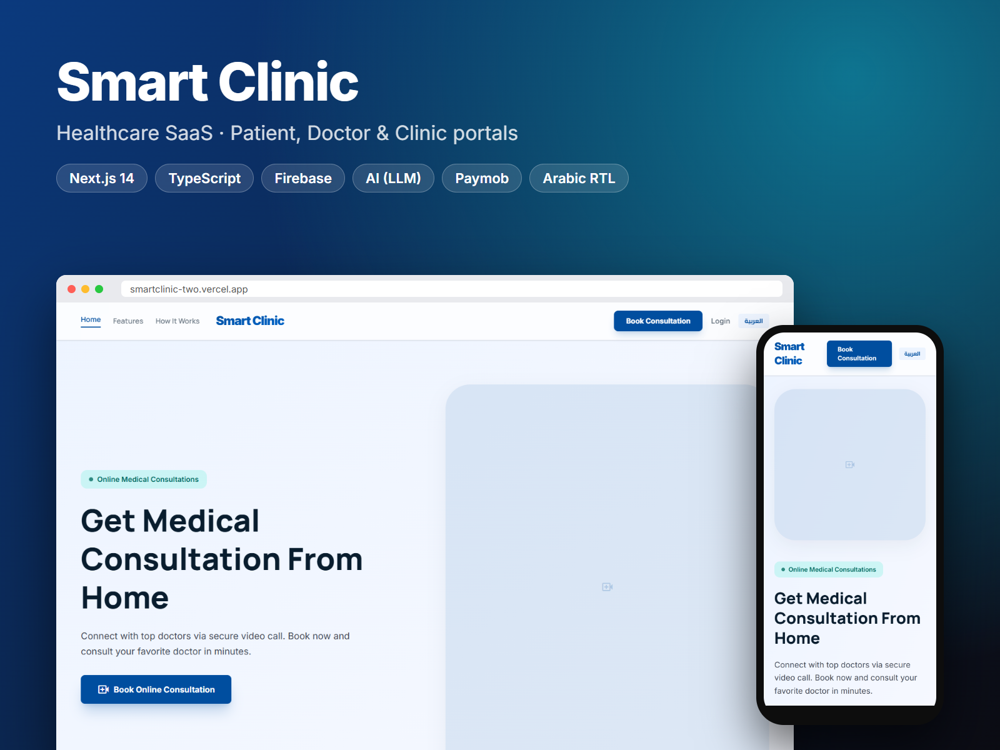
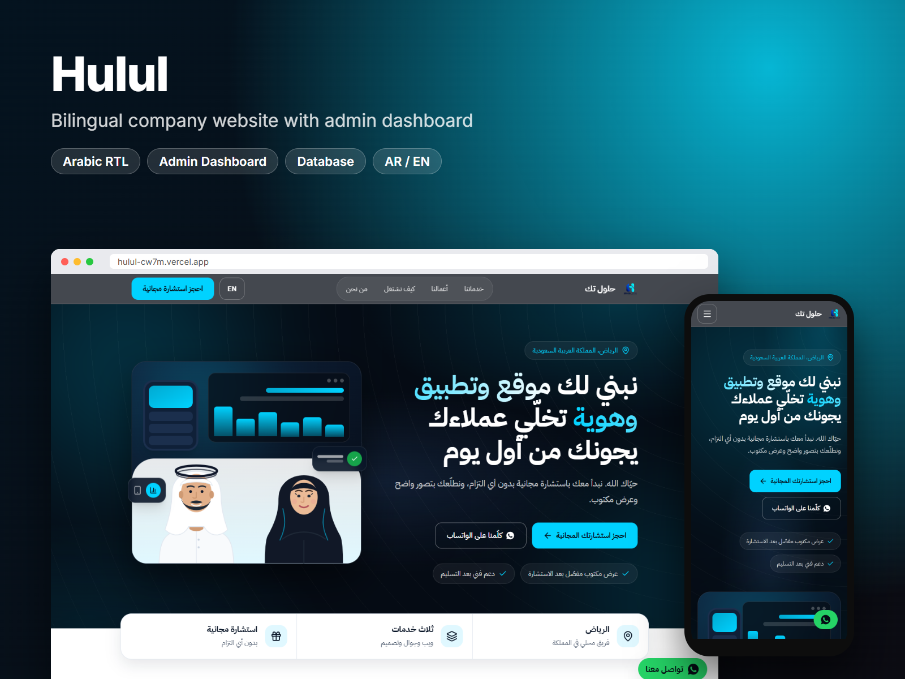
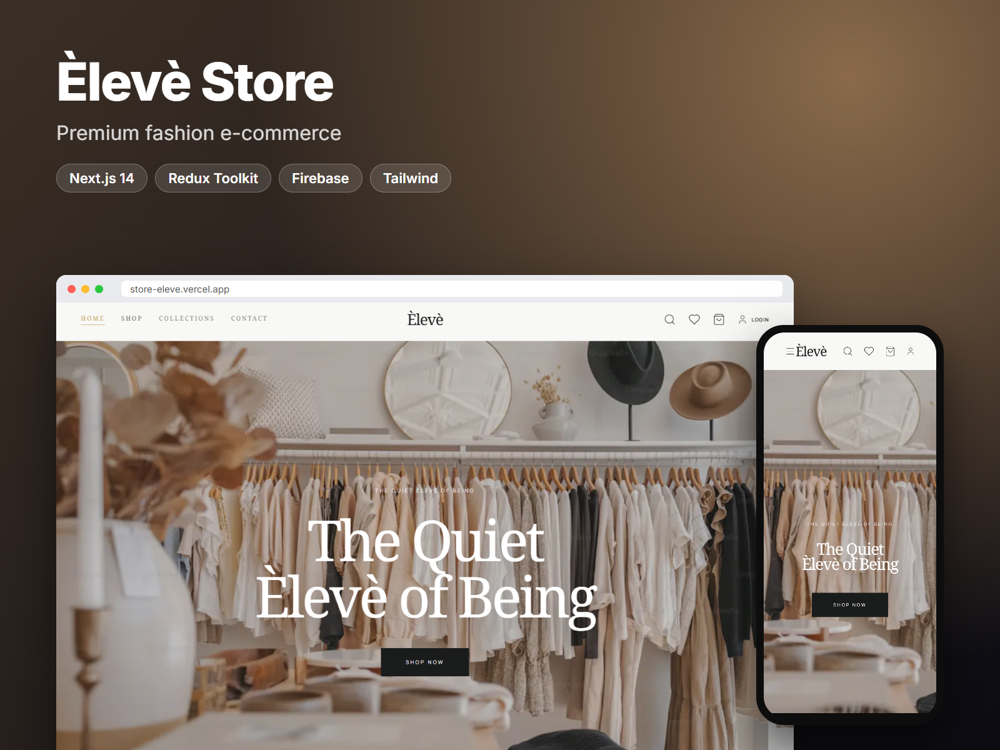
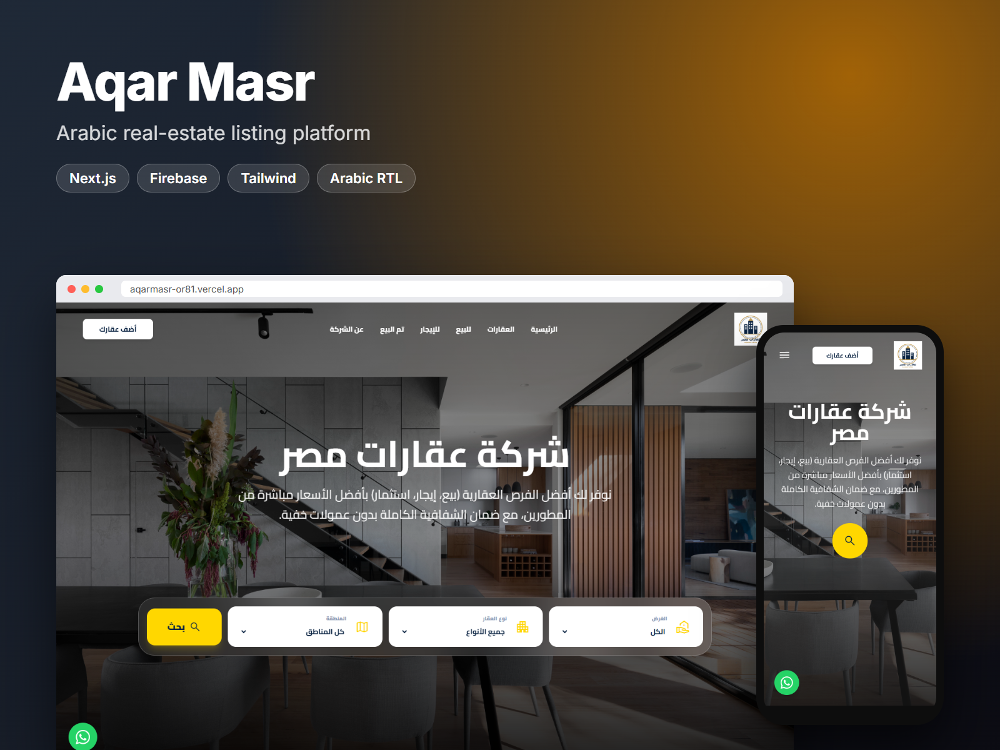
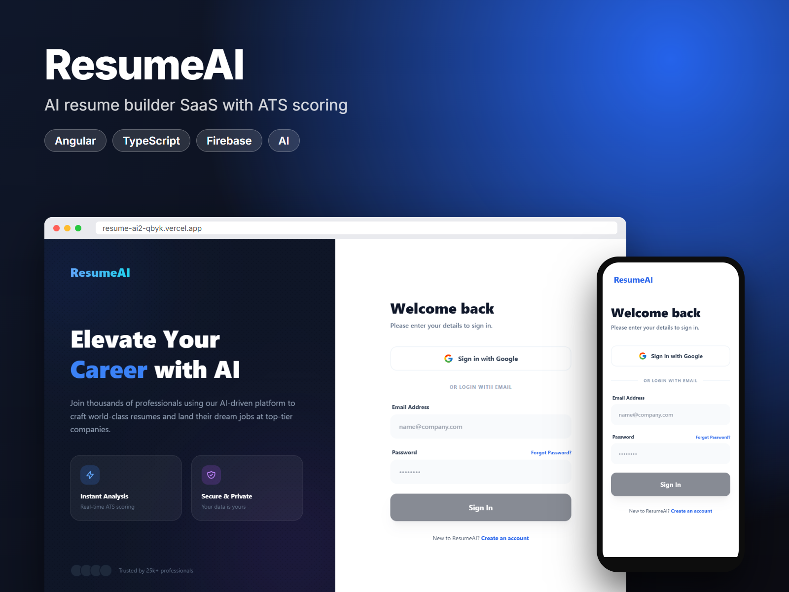
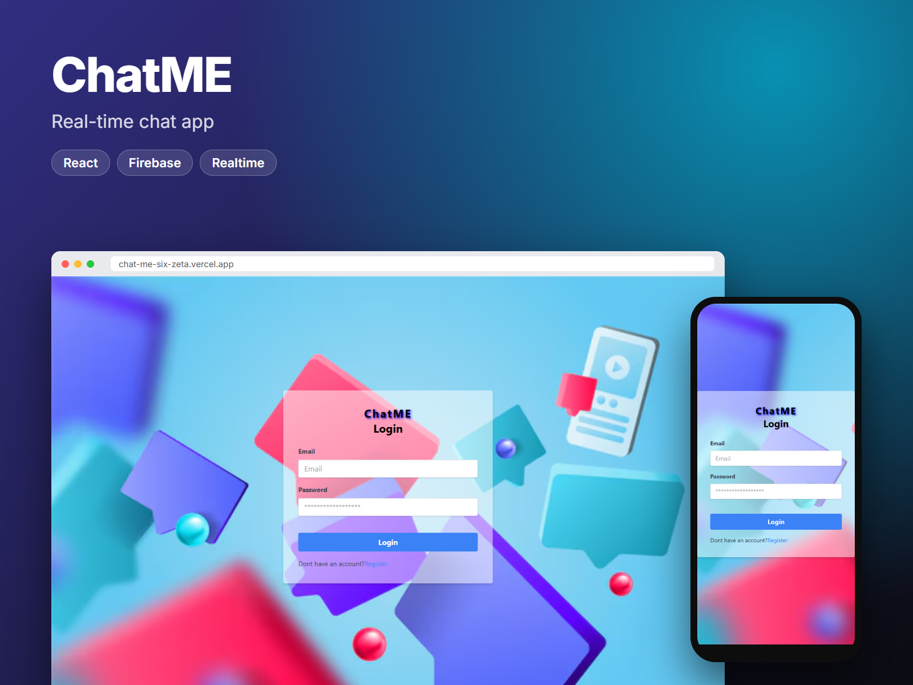
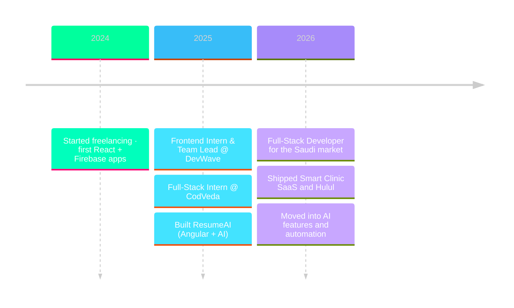

<p align="center">
  
</p>

<p align="center">
  
</p>

<p align="center">
  <a href="https://mohamed-wael-m.vercel.app/"></a>&nbsp;
  <a href="https://www.linkedin.com/in/mohamed-wael-469744273/"></a>&nbsp;
  <a href="mailto:mohamedwaeltorad@gmail.com"></a>&nbsp;
  &nbsp;
  
</p>


### `~/about`

<table border="0">
<tr>
<td width="55%" valign="top">

I'm a full-stack developer from Cairo, working remotely with teams in Saudi Arabia. I design and ship complete products: the UI, the API, the database, the admin dashboard, and the deployment.

My work lives in the Gulf market, so most of what I build is **bilingual Arabic / English with full RTL**, and most of it carries real users, payments, and roles.

- 🇸🇦 &nbsp;2+ years building production web apps, currently for the Saudi market
- 🤖 &nbsp;Exploring LLM features, **n8n** automation and the **WhatsApp Cloud API**
- 💬 &nbsp;Open to freelance and remote work

</td>
<td width="45%" valign="top">

```ts
// what you get when you work with me
export const deliverables = {
  frontend : "Next.js · React · TypeScript",
  backend  : "Node.js · Django · REST",
  database : "PostgreSQL · MySQL · Firebase",
  mobile   : "React Native (Expo)",
  extras   : ["admin dashboard", "RTL", "CI/CD"],
  handover : "Vercel · GitHub · docs",
} as const;
```

</td>
</tr>
</table>


### `~/stack`

<p align="center">
  <br/>
  <br/>
  <br/>
  
</p>


### `~/work`

<table border="0">
  <tr>
    <td width="50%" valign="top">
      <a href="https://smartclinic-two.vercel.app/"></a>
      <br/><br/>
      <b>Smart Clinic</b> · Healthcare SaaS<br/>
      <sub>Patient, Doctor and Clinic portals · e-prescriptions · AI follow-ups · real-time chat · Paymob · PWA</sub><br/>
      <sub><code>Next.js 14</code> <code>TypeScript</code> <code>Firebase</code> <code>AI</code></sub>
    </td>
    <td width="50%" valign="top">
      <a href="https://hulul-cw7m.vercel.app/"></a>
      <br/><br/>
      <b>Hulul</b> · Bilingual company website<br/>
      <sub>AR/EN corporate site for a Riyadh agency · booking · WhatsApp · admin dashboard + database</sub><br/>
      <sub><code>Next.js</code> <code>TypeScript</code> <code>Tailwind</code></sub>
    </td>
  </tr>
  <tr>
    <td width="50%" valign="top">
      <a href="https://store-eleve.vercel.app/"></a>
      <br/><br/>
      <b>Èlevè Store</b> · Fashion e-commerce<br/>
      <sub>Collections · wishlist · cart · auth · admin dashboard for products and orders</sub><br/>
      <sub><code>Next.js 14</code> <code>Redux Toolkit</code> <code>Firebase</code></sub>
    </td>
    <td width="50%" valign="top">
      <a href="https://aqarmasr-or81.vercel.app/"></a>
      <br/><br/>
      <b>Aqar Masr</b> · Real-estate platform<br/>
      <sub>Arabic RTL listings · filters by type and area · property submission · admin dashboard</sub><br/>
      <sub><code>Next.js</code> <code>Firebase</code> <code>Tailwind</code></sub>
    </td>
  </tr>
  <tr>
    <td width="50%" valign="top">
      <a href="https://resume-ai2-qbyk.vercel.app/login"></a>
      <br/><br/>
      <b>ResumeAI</b> · AI resume builder<br/>
      <sub>AI-generated resumes with live ATS scoring · Google and email auth</sub><br/>
      <sub><code>Angular</code> <code>TypeScript</code> <code>Firebase</code></sub>
    </td>
    <td width="50%" valign="top">
      <a href="https://chat-me-six-zeta.vercel.app/"></a>
      <br/><br/>
      <b>ChatME</b> · Real-time chat<br/>
      <sub>Registration, login and live conversations on Firebase</sub><br/>
      <sub><code>React</code> <code>Firebase</code></sub>
    </td>
  </tr>
</table>

<p align="center">
  <a href="https://mohamed-wael-m.vercel.app/"></a>
</p>


### `~/journey`




### `~/stats`

<p align="center">
  
  
</p>
<p align="center">
  
</p>
<p align="center">
  
</p>


### `~/contact`

<p align="center">
  Have a web app, dashboard or mobile app in mind? I reply with a clear plan, timeline and estimate.
</p>

<p align="center">
  <a href="mailto:mohamedwaeltorad@gmail.com"></a>&nbsp;
  <a href="https://www.linkedin.com/in/mohamed-wael-469744273/"></a>&nbsp;
  <a href="https://mohamed-wael-m.vercel.app/"></a>
</p>

<p align="center">
  
</p>
