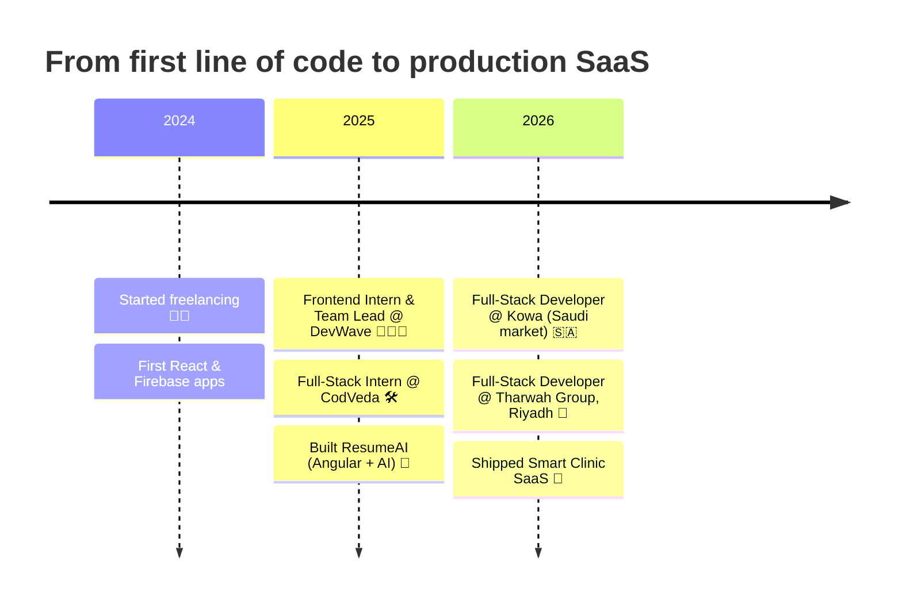

<!-- ═══════════════════════ HEADER ═══════════════════════ -->


<div align="center">
  
</div>

<div align="center">
  <a href="https://mohamed-wael-m.vercel.app/"></a>
  <a href="https://www.linkedin.com/in/mohamed-wael-469744273/"></a>
  <a href="mailto:mohamedwaeltorad@gmail.com"></a>
</div>

<div align="center">
  
  
  
  
</div>


<!-- ═══════════════════════ ABOUT ═══════════════════════ -->
##  About Me

<table>
<tr>
<td width="58%" valign="top">

```typescript
const mohamed = {
  name: "Mohamed Wael",
  role: "Full-Stack Developer",
  company: "Tharwah Group (Riyadh, remote)",
  location: "Cairo, Egypt 🇪🇬",
  stack: ["Next.js", "React", "TypeScript",
          "Node.js", "Python/Django", "React Native"],
  databases: ["PostgreSQL", "MySQL", "MongoDB",
              "Firebase", "Supabase"],
  focus: ["SaaS platforms", "Admin dashboards",
          "E-commerce", "Arabic/English RTL apps",
          "AI & automation (n8n, WhatsApp API)"],
  motto: "Ship it clean. Ship it fast. Ship it with a dashboard.",
};
```

</td>
<td width="42%" align="center" valign="top">
  
</td>
</tr>
</table>

<div align="center">
  
</div>

<!-- ═══════════════════════ JOURNEY ═══════════════════════ -->
##  My Journey



<!-- ═══════════════════════ WHAT I BUILD ═══════════════════════ -->
##  What I Build

<div align="center">
<table>
  <tr>
    <td align="center" width="25%">
      <br/>
      <b>SaaS Platforms</b><br/>
      <sub>Multi-role portals, auth, billing, real-time features</sub>
    </td>
    <td align="center" width="25%">
      <br/>
      <b>Admin Dashboards</b><br/>
      <sub>Analytics, CRUD, roles & permissions, reports</sub>
    </td>
    <td align="center" width="25%">
      <br/>
      <b>E-commerce</b><br/>
      <sub>Catalog, cart, checkout, payments (Paymob & more)</sub>
    </td>
    <td align="center" width="25%">
      <br/>
      <b>AI & Automation</b><br/>
      <sub>LLM features, n8n flows, WhatsApp Cloud API bots</sub>
    </td>
  </tr>
</table>
</div>


<!-- ═══════════════════════ TECH ═══════════════════════ -->
##  Tech Stack

<div align="center">

### 🎨 Frontend


### ⚙️ Backend & APIs


### 🗄️ Databases & Cloud


### 📱 Mobile, Tools & Automation


<br/>


</div>


<!-- ═══════════════════════ PROJECTS ═══════════════════════ -->
##  Featured Projects

<table>
  <tr>
    <td width="50%" valign="top">
      <a href="https://smartclinic-two.vercel.app/"></a>
      <h3 align="center">🏥 Smart Clinic — Healthcare SaaS</h3>
      <p>Clinic management SaaS with three portals (Patient, Doctor, Clinic ERP). Bilingual AR/EN with RTL, ICD-10 e-prescriptions, AI patient follow-ups, real-time chat, Paymob payments, PWA, admin dashboard.</p>
      <p align="center">
        
        
        
        
        <br/><a href="https://smartclinic-two.vercel.app/"><b>🔗 Live Demo</b></a>
      </p>
    </td>
    <td width="50%" valign="top">
      <a href="https://hulul-cw7m.vercel.app/"></a>
      <h3 align="center">🏢 Hulul — Bilingual Company Website</h3>
      <p>Arabic/English corporate site for a Riyadh digital agency: services, portfolio, process, consultation booking, WhatsApp contact, with an admin dashboard and database for content management.</p>
      <p align="center">
        
        
        
        <br/><a href="https://hulul-cw7m.vercel.app/"><b>🔗 Live Demo</b></a>
      </p>
    </td>
  </tr>
  <tr>
    <td width="50%" valign="top">
      <a href="https://store-eleve.vercel.app/"></a>
      <h3 align="center">🛍️ Èlevè Store — Fashion E-commerce</h3>
      <p>Premium fashion store with collections, product pages, wishlist, cart, authentication and an admin dashboard for products and orders.</p>
      <p align="center">
        
        
        
        <br/><a href="https://store-eleve.vercel.app/"><b>🔗 Live Demo</b></a>
      </p>
    </td>
    <td width="50%" valign="top">
      <a href="https://aqarmasr-or81.vercel.app/"></a>
      <h3 align="center">🏠 Aqar Masr — Real-Estate Platform</h3>
      <p>Arabic RTL real-estate platform: filter listings by offer type, property type and area, submit properties, contact the agency on WhatsApp. Admin dashboard and database included.</p>
      <p align="center">
        
        
        
        <br/><a href="https://aqarmasr-or81.vercel.app/"><b>🔗 Live Demo</b></a>
      </p>
    </td>
  </tr>
  <tr>
    <td width="50%" valign="top">
      <a href="https://resume-ai2-qbyk.vercel.app/login"></a>
      <h3 align="center">🤖 ResumeAI — AI Resume Builder</h3>
      <p>SaaS that builds resumes with AI and scores them against ATS in real time. Google and email auth, user dashboard.</p>
      <p align="center">
        
        
        
        <br/><a href="https://resume-ai2-qbyk.vercel.app/login"><b>🔗 Live Demo</b></a>
      </p>
    </td>
    <td width="50%" valign="top">
      <a href="https://chat-me-six-zeta.vercel.app/"></a>
      <h3 align="center">💬 ChatME — Real-time Chat</h3>
      <p>Real-time messaging app with registration, login and live conversations on Firebase.</p>
      <p align="center">
        
        
        <br/><a href="https://chat-me-six-zeta.vercel.app/"><b>🔗 Live Demo</b></a>
      </p>
    </td>
  </tr>
</table>

<div align="center">
  <a href="https://mohamed-wael-m.vercel.app/"></a>
</div>


<!-- ═══════════════════════ STATS ═══════════════════════ -->
##  GitHub Stats

<div align="center">
  
  
</div>

<div align="center">
  
</div>

<div align="center">
  
</div>

<div align="center">
  
</div>

<div align="center">
  
</div>


<!-- ═══════════════════════ CONTACT ═══════════════════════ -->
##  Let's Build Something

<div align="center">

 &nbsp;Have a web app, dashboard or mobile app in mind? I reply with a clear plan, timeline and estimate.

<a href="https://mohamed-wael-m.vercel.app/"></a>
<a href="https://www.linkedin.com/in/mohamed-wael-469744273/"></a>
<a href="mailto:mohamedwaeltorad@gmail.com"></a>

<br/>


</div>

<!-- Footer wave -->

