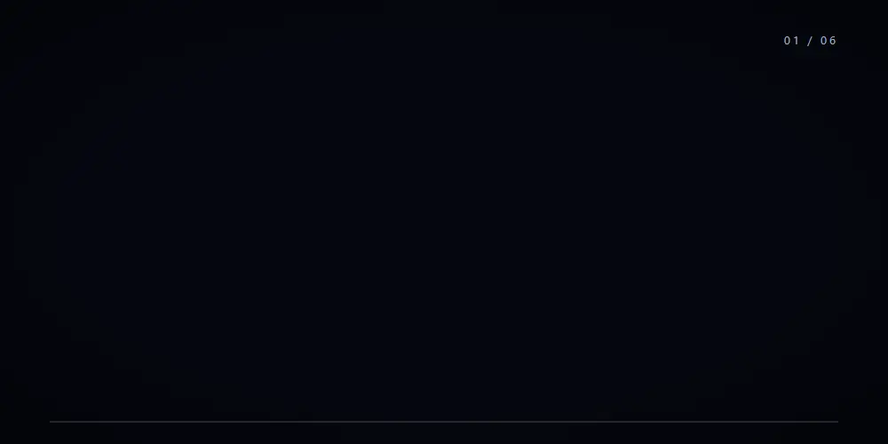
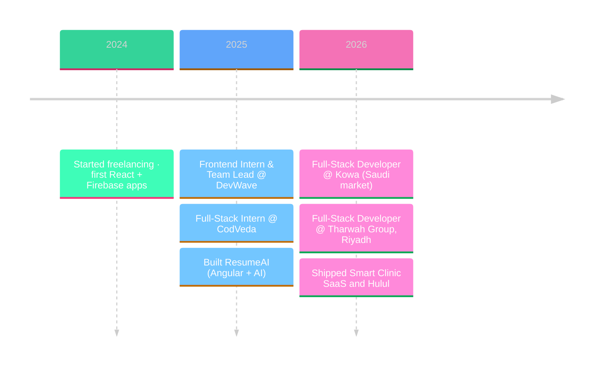

<p align="center">
  
</p>

<p align="center">
  <a href="https://mohamed-wael-m.vercel.app/"></a>&nbsp;
  <a href="https://www.linkedin.com/in/mohamed-wael-469744273/"></a>&nbsp;
  <a href="mailto:mohamedwaeltorad@gmail.com"></a>&nbsp;
  
</p>

<br/>

<table border="0">
<tr>
<td width="56%" valign="top">

### About

I'm a full-stack developer from Cairo working remotely with teams in Saudi Arabia. I design and ship complete products: the UI, the API, the database, the admin dashboard and the deployment.

Most of what I build is **bilingual Arabic / English with full RTL**, carrying real users, payments and roles.

- 🚀 &nbsp;2+ years shipping production web apps
- 🇸🇦 &nbsp;Currently building for the Saudi market
- 🤖 &nbsp;Exploring LLM features, **n8n** and the **WhatsApp Cloud API**
- 💬 &nbsp;Open to freelance and remote work

</td>
<td width="44%" valign="top">

```ts
const mohamed = {
  frontend : "Next.js · React · TypeScript",
  backend  : "Node.js · Django · REST",
  database : "PostgreSQL · MySQL · Firebase",
  mobile   : "React Native (Expo)",
  extras   : ["admin dashboard", "RTL", "CI/CD"],
  base     : "Cairo 🇪🇬  →  Riyadh 🇸🇦",
};
```

</td>
</tr>
</table>

<br/>

### Featured work

<p align="center">
  
</p>

<table border="0">
  <tr>
    <td align="center" width="16.6%"><a href="https://smartclinic-two.vercel.app/"><br/><sub><b>Smart Clinic</b></sub></a></td>
    <td align="center" width="16.6%"><a href="https://hulul-cw7m.vercel.app/"><br/><sub><b>Hulul</b></sub></a></td>
    <td align="center" width="16.6%"><a href="https://store-eleve.vercel.app/"><br/><sub><b>Èlevè Store</b></sub></a></td>
    <td align="center" width="16.6%"><a href="https://aqarmasr-or81.vercel.app/"><br/><sub><b>Aqar Masr</b></sub></a></td>
    <td align="center" width="16.6%"><a href="https://resume-ai2-qbyk.vercel.app/login"><br/><sub><b>ResumeAI</b></sub></a></td>
    <td align="center" width="16.6%"><a href="https://chat-me-six-zeta.vercel.app/"><br/><sub><b>ChatME</b></sub></a></td>
  </tr>
</table>

<p align="center">
  <a href="https://mohamed-wael-m.vercel.app/"></a>
</p>

<br/>

### Stack

<p align="center">
  
</p>

<br/>

### Journey



<p align="center">
  <a href="https://tharwah.net/"></a>&nbsp;
  <a href="https://kowa.sa/"></a>
</p>

<br/>

### Stats

<p align="center">
  
  
</p>
<p align="center">
  
</p>

<br/>

### Let's build something

<p align="center">
  Have a web app, dashboard or mobile app in mind? I reply with a clear plan, timeline and estimate.
</p>

<p align="center">
  <a href="mailto:mohamedwaeltorad@gmail.com"></a>&nbsp;
  <a href="https://www.linkedin.com/in/mohamed-wael-469744273/"></a>&nbsp;
  <a href="https://mohamed-wael-m.vercel.app/"></a>
</p>
