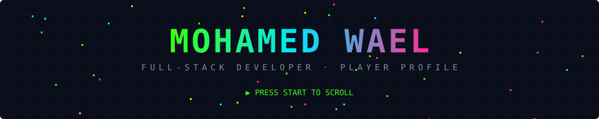
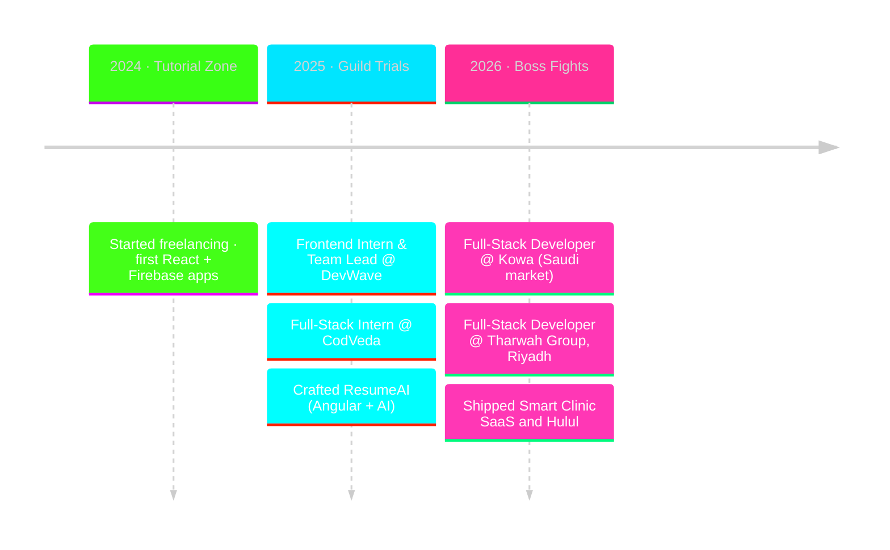

<p align="center">
  
</p>

<p align="center">
  <a href="https://mohamed-wael-m.vercel.app/"></a>&nbsp;
  <a href="https://www.linkedin.com/in/mohamed-wael-469744273/"></a>&nbsp;
  <a href="mailto:mohamedwaeltorad@gmail.com"></a>&nbsp;
  
</p>

<!-- ▀▀▀▀▀▀▀▀▀▀▀▀▀▀▀▀▀▀▀▀▀▀▀▀▀▀▀▀▀▀ CHARACTER ▀▀▀▀▀▀▀▀▀▀▀▀▀▀▀▀▀▀▀▀▀▀▀▀▀▀▀▀▀▀ -->

<p align="center">
  
</p>

<table border="0">
<tr>
<td width="50%" valign="top">

**📜 LORE**

A full-stack developer from Cairo who spawned in 2024 with React and Firebase, levelled up through two internships, and now ships production SaaS for the Saudi market. Builds the whole thing: UI, API, database, admin dashboard, deployment.

Speciality: **bilingual Arabic / English products with full RTL**, with real users, payments and roles.

</td>
<td width="50%" valign="top">

**⚔️ LOADOUT**

```ts
const loadout = {
  mainHand : "Next.js + TypeScript",
  offHand  : "Node.js / Django APIs",
  armor    : "PostgreSQL · MySQL · Firebase",
  mount    : "React Native (Expo)",
  potions  : ["n8n", "WhatsApp Cloud API", "LLMs"],
  spawn    : "Cairo 🇪🇬  →  Riyadh 🇸🇦",
};
```

</td>
</tr>
</table>

<!-- ▀▀▀▀▀▀▀▀▀▀▀▀▀▀▀▀▀▀▀▀▀▀▀▀▀▀▀▀▀▀ SKILLS ▀▀▀▀▀▀▀▀▀▀▀▀▀▀▀▀▀▀▀▀▀▀▀▀▀▀▀▀▀▀ -->

<p align="center">
  
</p>

<p align="center">
  
</p>

<!-- ▀▀▀▀▀▀▀▀▀▀▀▀▀▀▀▀▀▀▀▀▀▀▀▀▀▀▀▀▀▀ QUESTS ▀▀▀▀▀▀▀▀▀▀▀▀▀▀▀▀▀▀▀▀▀▀▀▀▀▀▀▀▀▀ -->

<p align="center">
  
</p>

<table border="0">
  <tr>
    <td width="50%" valign="top">
      <a href="https://smartclinic-two.vercel.app/"></a>
      <p align="center"><sub>🏆 LEGENDARY</sub><br/><b>Smart Clinic</b> · Healthcare SaaS<br/><sub><code>Next.js 14</code> <code>TypeScript</code> <code>Firebase</code> <code>AI</code> <code>Paymob</code></sub></p>
    </td>
    <td width="50%" valign="top">
      <a href="https://hulul-cw7m.vercel.app/"></a>
      <p align="center"><sub>💎 EPIC</sub><br/><b>Hulul</b> · Bilingual company website<br/><sub><code>Next.js</code> <code>TypeScript</code> <code>Tailwind</code> <code>Admin dashboard</code></sub></p>
    </td>
  </tr>
  <tr>
    <td width="50%" valign="top">
      <a href="https://store-eleve.vercel.app/"></a>
      <p align="center"><sub>💎 EPIC</sub><br/><b>Èlevè Store</b> · Fashion e-commerce<br/><sub><code>Next.js 14</code> <code>Redux Toolkit</code> <code>Firebase</code></sub></p>
    </td>
    <td width="50%" valign="top">
      <a href="https://aqarmasr-or81.vercel.app/"></a>
      <p align="center"><sub>🔷 RARE</sub><br/><b>Aqar Masr</b> · Real-estate platform<br/><sub><code>Next.js</code> <code>Firebase</code> <code>Arabic RTL</code></sub></p>
    </td>
  </tr>
  <tr>
    <td width="50%" valign="top">
      <a href="https://resume-ai2-qbyk.vercel.app/login"></a>
      <p align="center"><sub>🔷 RARE</sub><br/><b>ResumeAI</b> · AI resume builder<br/><sub><code>Angular</code> <code>TypeScript</code> <code>Firebase</code></sub></p>
    </td>
    <td width="50%" valign="top">
      <a href="https://chat-me-six-zeta.vercel.app/"></a>
      <p align="center"><sub>🟢 COMMON</sub><br/><b>ChatME</b> · Real-time chat<br/><sub><code>React</code> <code>Firebase</code></sub></p>
    </td>
  </tr>
</table>

<p align="center">
  <a href="https://mohamed-wael-m.vercel.app/"></a>
</p>

<!-- ▀▀▀▀▀▀▀▀▀▀▀▀▀▀▀▀▀▀▀▀▀▀▀▀▀▀▀▀▀▀ ACHIEVEMENTS ▀▀▀▀▀▀▀▀▀▀▀▀▀▀▀▀▀▀▀▀▀▀▀▀▀▀▀▀▀▀ -->

<p align="center">
  
</p>

<!-- ▀▀▀▀▀▀▀▀▀▀▀▀▀▀▀▀▀▀▀▀▀▀▀▀▀▀▀▀▀▀ CAMPAIGN ▀▀▀▀▀▀▀▀▀▀▀▀▀▀▀▀▀▀▀▀▀▀▀▀▀▀▀▀▀▀ -->

### `🗺️ CAMPAIGN MAP`



<p align="center">
  <a href="https://tharwah.net/"></a>&nbsp;
  <a href="https://kowa.sa/"></a>
</p>

<!-- ▀▀▀▀▀▀▀▀▀▀▀▀▀▀▀▀▀▀▀▀▀▀▀▀▀▀▀▀▀▀ STATS ▀▀▀▀▀▀▀▀▀▀▀▀▀▀▀▀▀▀▀▀▀▀▀▀▀▀▀▀▀▀ -->

### `📊 PLAYER STATS`

<p align="center">
  
  
</p>
<p align="center">
  
</p>
<p align="center">
  
</p>

<!-- ▀▀▀▀▀▀▀▀▀▀▀▀▀▀▀▀▀▀▀▀▀▀▀▀▀▀▀▀▀▀ CONTACT ▀▀▀▀▀▀▀▀▀▀▀▀▀▀▀▀▀▀▀▀▀▀▀▀▀▀▀▀▀▀ -->

### `🎮 START A NEW QUEST`

<p align="center">
  Have a web app, dashboard or mobile app in mind? Send the quest brief and I reply with a clear plan, timeline and estimate.
</p>

<p align="center">
  <a href="mailto:mohamedwaeltorad@gmail.com"></a>&nbsp;
  <a href="https://www.linkedin.com/in/mohamed-wael-469744273/"></a>&nbsp;
  <a href="https://mohamed-wael-m.vercel.app/"></a>
</p>

<p align="center">
  
</p>
